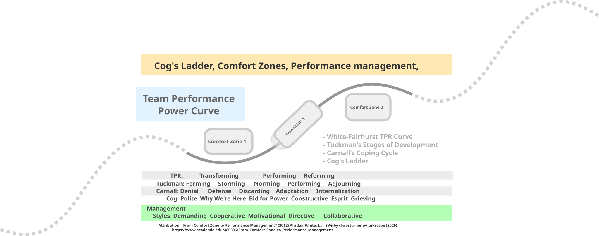

# tech-performance-curves

A chart developed from:
- White, Alasdair (2009). "From Comfort Zone to Performance Management: Understanding Development and Performance". White & MacLean Publishing. ISBN 978-2-930583-01-3.  [/?](https://www.google.com/search?q="From+Comfort+Zone+to+Performance+Management") [gscholar](https://scholar.google.com/scholar?cluster=15797989760588958687&hl=en&as_sdt=0,43) [academia.edu](https://www.academia.edu/460306/From_Comfort_Zone_to_Performance_Management) 
